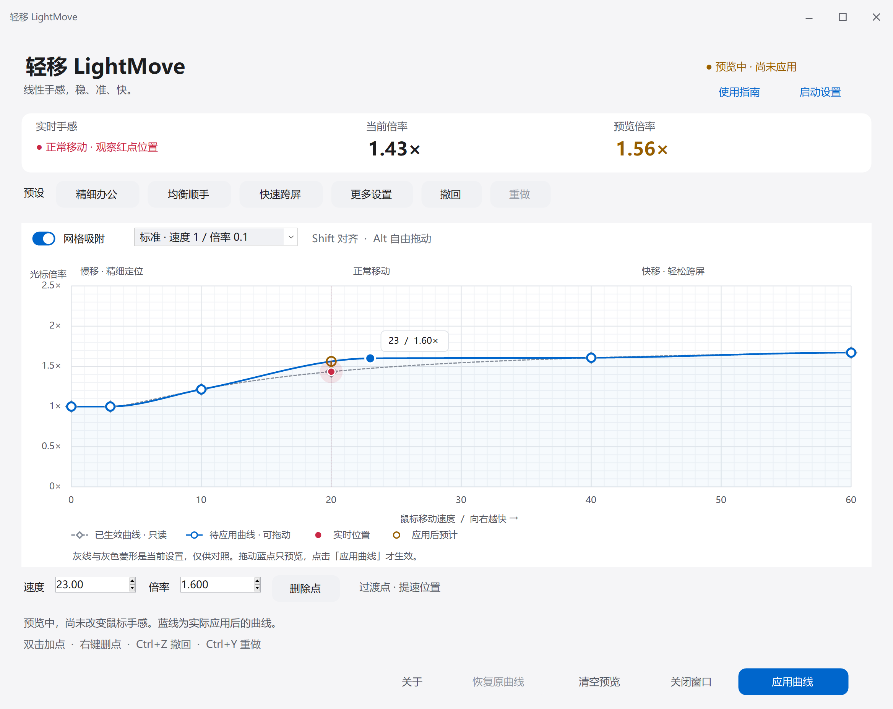
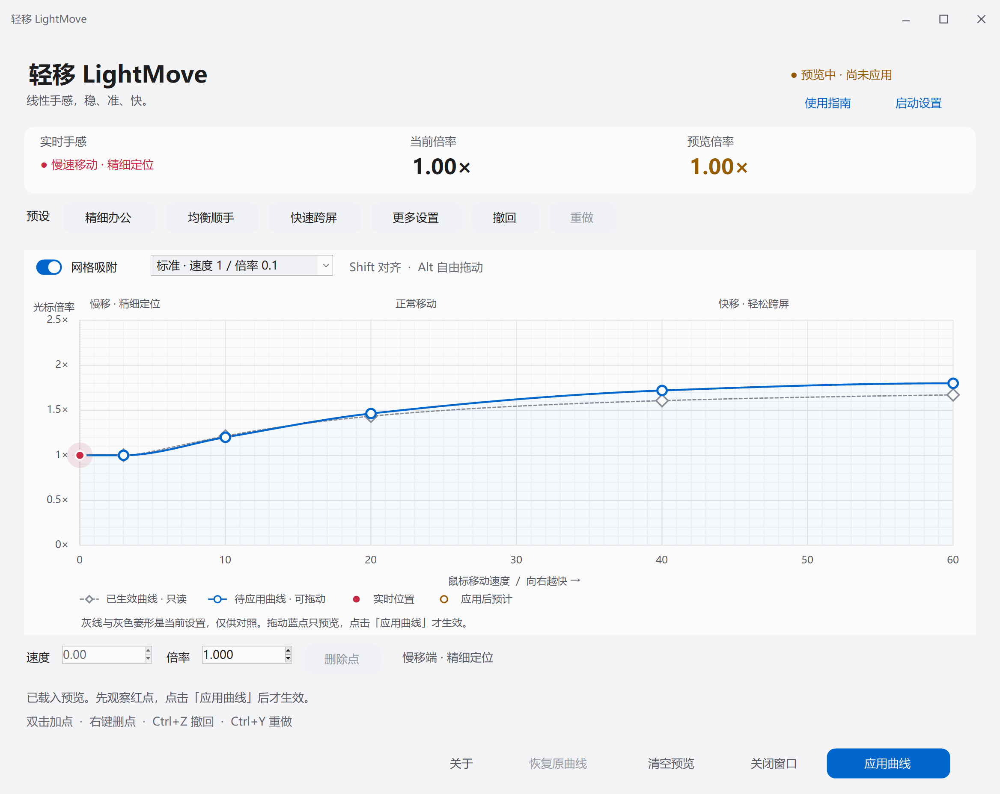

<h1 align="center">轻移 LightMove</h1>

<strong>少挪手腕，稳准到位。</strong>

适用于 Windows 的鼠标手感调节工具

Windows 10 / 11 · x64 · 社区预览版

<a href="https://github.com/skystart233-code/rawaccel/releases">下载</a> · <a href="README.zh-CN.md">使用指南</a> · <a href="CHANGELOG.md">更新记录</a> · <a href="https://github.com/skystart233-code/rawaccel/issues">问题反馈</a>

轻移以**减少手腕反复挪动**为设计目标。灵感来自轨迹球，将普通鼠标熟悉的指向操作与小幅动作跨屏的思路相结合：慢速移动时保留精细定位，较快移动时扩大光标行程。

继续使用现有鼠标，通过可视化曲线，为精细操作和大范围移动分别设置合适的倍率。

## 核心体验

**精细操作，保持可控。** 为慢速移动设置平稳的倍率，便于点击小目标、选择文字和调整细节。

**跨越屏幕，减少往返。** 为较快移动设置更高倍率，以较小的鼠标行程完成较远的光标移动，减少反复挪动与重新摆位的需要。

**保留习惯，自定义手感。** 延续普通鼠标的握持、指向与点击方式，借鉴轨迹球的小幅跨屏思路，根据设备、屏幕和个人习惯调整移动节奏。

## 快速开始

1. 从 [Releases](https://github.com/skystart233-code/rawaccel/releases) 下载 Windows x64 EXE，双击运行。
2. 首次使用按引导安装官方驱动，保存工作后重启一次。驱动已就绪时可直接使用。
3. 选择预设，移动鼠标观察实时红点，拖动蓝色控制点调整曲线。
4. 点击 **应用曲线** 保存并生效。

调整过程只改变预览。驱动就绪后，修改曲线无需重启。

## 功能概览

| 功能 | 说明 |
|---|---|
| 可视化曲线编辑 | 拖动控制点调整倍率，支持精确数值输入及水平 / 垂直方向分别设置 |
| 实时效果对照 | 同时显示已生效曲线、待应用曲线及当前鼠标移动位置 |
| 网格与对齐 | 标准 / 精细吸附，Shift 对齐高度，Alt 临时自由拖动 |
| 撤回与重做 | 支持 Ctrl+Z / Ctrl+Y，本次打开期间保留最近 100 步调整 |
| 配置备份与恢复 | 应用前备份，写入后核对；可恢复本次打开前的曲线 |
| 启动与托盘 | 可选登录后自启、后台启动，以及关闭 / 最小化收进托盘 |

### 曲线标记

| 标记 | 含义 |
|---|---|
| 灰色虚线与菱形 | 当前已生效的设置，只读对照 |
| 蓝色实线与圆点 | 待应用的设置，圆点可拖动 |
| 实心红点 | 当前移动速度下的实际曲线位置 |
| 空心橙点 | 应用新设置后的预计位置 |

界面图使用示例曲线；动图为模拟输入交互演示。

### 预设与个性化

| 预设 | 适用侧重 | 高速端倍率 |
|---|---|---|
| 精细办公 | 小目标与细节操作 | 1.5× |
| 均衡顺手 | 兼顾精调与跨屏 | 1.8× |
| 快速跨屏 | 较大范围的光标移动 | 2.2× |

预设是调整起点，选择后仍需点击 **应用曲线** 才生效。完整操作和快捷键见 [使用指南](README.zh-CN.md)。

### 启动与后台运行

通过首页 **启动设置** 管理登录后自启和托盘行为。开机自启默认关闭，仅为当前 Windows 用户设置。

关闭或最小化窗口默认收进系统托盘，保留尚未应用的调整。双击托盘图标或再次运行 EXE 可恢复已有窗口；右键托盘图标，选择 **退出轻移** 可结束软件。

退出软件后，驱动仍保持当前已生效的曲线。需要恢复原设置时，请先点击 **恢复原曲线**。

## 系统要求

| 项目 | 要求 |
|---|---|
| 操作系统 | Windows 10 / Windows 11 |
| 架构 | x64 |
| 运行环境 | .NET Framework 4.7.2+、Visual C++ x64 运行库 |
| 首次安装 | 安装驱动需要管理员授权，并重启一次 |

当前为社区预览版。界面程序尚无额外代码签名；随附驱动保留官方原文件与签名。兼容性与验证范围见 [验证记录](docs/VALIDATION.md)。

## 文档与支持

- [使用指南](README.zh-CN.md)：曲线调节、快捷键、配置与恢复。
- [更新记录](CHANGELOG.md)：版本功能与变更。
- [开发指南](docs/DEVELOPMENT.md)：项目结构、构建与测试。
- [架构说明](docs/ARCHITECTURE.md)：输入、配置及桌面生命周期。
- [问题反馈](https://github.com/skystart233-code/rawaccel/issues)：提交系统环境、软件版本、复现步骤与截图。
- [参与贡献](CONTRIBUTING.md)：开发约定与贡献方式。

## 项目来源与许可

轻移基于 [Raw Accel v1.7.1](https://github.com/RawAccelOfficial/rawaccel/releases/tag/v1.7.1) 扩展中文界面与桌面交互，保留其官方驱动及封装库。感谢 Raw Accel 作者与贡献者。

“线性手感”描述平顺、可控的操作体验。软件通过可自定义的速度曲线调整光标倍率，不改写硬件 DPI；也支持将曲线拉平，提供固定倍率。减少手腕反复移动是设计目标，实际舒适度因设备与使用习惯而异，尚无医疗功效验证。

MIT License · Copyright (c) 2020 a1xd。详见 [LICENSE](LICENSE)。
